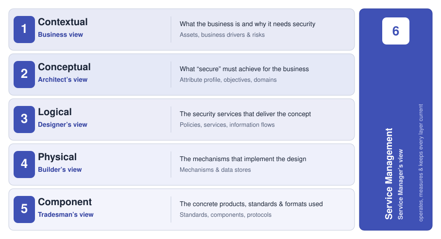
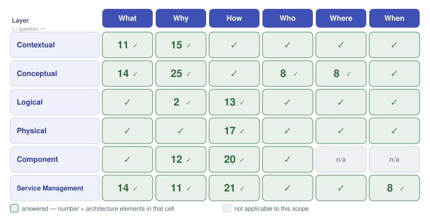
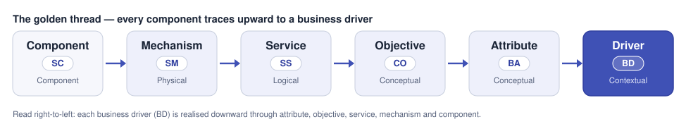

# SABSA Security Architecture

MethodAtlas ships with a complete **SABSA** security-architecture library. It is the
document that answers, element by element, *why this tool is trustworthy enough to produce
audit evidence* — and lets a reviewer trace every claim back to a business reason.

This page explains what SABSA is, walks through its layers, and shows how MethodAtlas
applies the method to itself. The full architecture document — all 199 elements, their
traceability and the evidence behind each — is published in full as
[The MethodAtlas SABSA Architecture](architecture.md), generated from the approved library.

## What SABSA is

**SABSA** (Sherwood Applied Business Security Architecture, maintained by the
[SABSA Institute](https://sabsa.org)) is a framework for building security architectures
that are *driven by business need rather than by technology*. Its central discipline is
simple and strict: **every security decision must trace upward to a business reason.** A
mechanism exists because a service needs it; the service exists because an objective
requires it; the objective exists because a measurable business attribute demands it; the
attribute exists because a business driver stated it. Nothing is included "because it is
good practice" — it is included because something above it needs it.

SABSA organises that chain as a stack of **six layers**, each written from the viewpoint of
a different role, and asks the **same six questions** — *What, Why, How, Who, Where, When* —
at every layer. The result is a 6×6 grid in which each cell has an owner and an answer.

## The six layers

Each layer re-expresses security at a different level of abstraction, from the business
that needs it down to the concrete components that deliver it. A sixth layer, **Service
Management**, runs vertically across all of them: it is how the architecture is operated,
measured and kept current.

<figure markdown>
  { width="880" }
  <figcaption>The SABSA layer model. Each layer is a <em>view</em> held by a different role; Service Management operates and measures every layer.</figcaption>
</figure>

| Layer | View | The question it settles |
| --- | --- | --- |
| **Contextual** | Business view | What the business is, and why it needs security at all. |
| **Conceptual** | Architect's view | What "secure" *means* here — expressed as measurable attributes. |
| **Logical** | Designer's view | The security services and information flows that deliver the concept. |
| **Physical** | Builder's view | The mechanisms and data structures that implement the design. |
| **Component** | Tradesman's view | The concrete products, standards and formats that make up the mechanisms. |
| **Service Management** | Service manager's view | How security is operated, measured, supported and kept current. |

See [The Six Layers](layers.md) for what each layer actually holds in the MethodAtlas
library.

## The 6×6 matrix

The six layers and the six questions form the **SABSA matrix**. MethodAtlas's library
settles all 36 cells — every layer answers every question, or records why a question does
not apply at that layer. The number in each cell is how many architecture elements sit
behind that answer.

<figure markdown>
  { width="900" }
  <figcaption>MethodAtlas's SABSA matrix — all 36 cells settled. Numbers are the architecture elements behind each answer; "n/a" marks a question that does not apply to a layer in this scope.</figcaption>
</figure>

## The golden thread — traceability

The point of SABSA is not the grid; it is the **thread** that runs through it. Every
component in the library can be followed upward — through the mechanism that uses it, the
service it belongs to, the control objective it meets, the business attribute it supports —
to the business driver that justifies its existence. MethodAtlas records this chain
explicitly for every element.

<figure markdown>
  { width="900" }
  <figcaption>The golden thread. Read right-to-left, each business driver is realised downward; read left-to-right, each component justifies itself upward to a business reason.</figcaption>
</figure>

## How MethodAtlas applies SABSA to itself

SABSA is normally applied to *a business and its estate*. MethodAtlas applies it to **its
own trustworthiness** — the security architecture of the product as it is built, maintained
and released, not the security of any one customer's deployment. The "asset" the
architecture protects is *the trustworthiness of MethodAtlas's output and of the process
that produces it* — its reason to exist for a regulated-industry audience.

!!! info "The library at a glance"
    **199 elements** across the six layers — 11 business drivers, 15 risks, 14 measurable
    attributes, 14 control objectives, 8 domains, 8 trust relationships, 11 architecture
    decisions, 13 logical services, 17 mechanisms, 12 standards, 20 components, and the
    service-management set (14 measures, 14 evidence artefacts, 7 operations, 11 exceptions,
    8 roadmap items). The library (version 6.1.0) is **owner-approved** against a hash-bound snapshot, so the
    document and the model cannot silently disagree.

### What "secure" means here — the attribute profile

At the Conceptual layer, "secure" is made concrete as a profile of **fourteen measurable
business attributes**, each with a definition, a metric, a measurement method and a target.
They are what turn trust from a claim into something the project can observe on its own
builds:

| | | |
| --- | --- | --- |
| **Authentic** | **Reproducible** | **Bounded** |
| **Taxonomy‑Stable** | **Schema‑Stable** | **Supply‑Chain‑Intact** |
| **Data‑Minimising** | **Confidential** | **Verifiably‑Tested** |
| **Supportable** | **Credible** | **Transparent** |
| **Audit‑Trail‑Intact** | **AI‑Result‑Reproducible** | |

Each attribute is driven by one or more of the eleven business drivers (BD‑001…BD‑011) and
is measured by the service-management layer's measures and evidence — closing the loop from
"what the business wants" to "evidence that we have it, regenerated on every build".

!!! tip "Where this connects"
    The attribute profile is the architectural backbone behind MethodAtlas's product
    promises: determinism (see [Reproducibility Receipts](../usage-modes/reproducibility-receipts.md)),
    bounded AI (see [Security Taxonomy](../ai/taxonomy.md)), data minimisation (see
    [Data Governance](../concepts/data-governance.md)) and the audit trail (see
    [Audit Trail](../audit-trail.md)).

## The full architecture document

This page is an orientation. The authoritative SABSA document — the executive summary, every
layer with all six questions answered, the full attribute profile with metrics and targets,
the governance register, the element register and the complete traceability table — is
published here in full, generated from the library so the document and the model can never
drift:

[:material-file-document-outline: Read the full SABSA architecture](architecture.md){ .md-button .md-button--primary }
